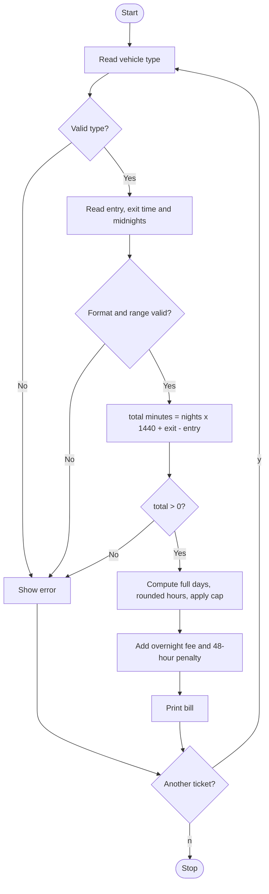

# Case Study 2: Smart Parking Fee Management
*(Original list number: 15)*

## 1. Problem Statement
Calculate the parking fee of a vehicle from its type, entry time, exit time and number of midnights crossed. The fee uses hourly rates, a daily cap, an overnight fee and a penalty for very long stays. All time inputs must be validated.

## 2. Objectives
- Validate time strings in HH:MM format using string operations.
- Convert times to minutes and compute the stay duration.
- Apply hourly rates (part hour rounded up), daily cap, overnight fee and penalty.
- Use parallel lists for vehicle categories, rates and caps.
- Repeat the process for several tickets using a while loop.

## 3. Assumptions
- Vehicle types: BIKE (Rs.10/h, cap Rs.80), CAR (Rs.20/h, cap Rs.150), TRUCK (Rs.40/h, cap Rs.300).
- Cap applies to each complete or partial 24-hour block.
- Overnight fee = Rs.50 for every midnight crossed.
- Penalty = Rs.200 if the stay is longer than 48 hours.
- The user types how many midnights were crossed (0 means same date).

## 4. Algorithm
1. Start; define lists of types, rates and caps.
2. Read vehicle type; reject unknown types.
3. Read entry and exit time as text; check length 5, ':' at position 2, digits elsewhere, hour 0-23, minute 0-59.
4. Read midnights crossed (must be a whole number).
5. total_minutes = midnights x 1440 + exit - entry; reject if not positive.
6. full_days = total_minutes // 1440; left_over = total_minutes % 1440; round left_over up to hours.
7. last_block = min(hours x rate, cap); parking = full_days x cap + last_block.
8. Add overnight fee and penalty (if over 48 hours); print the bill.
9. Ask whether to process another ticket; repeat or stop.

## 5. Pseudocode
```text
START
  types <- [BIKE, CAR, TRUCK]; rate <- [10,20,40]; cap <- [80,150,300]
  again <- "y"
  WHILE again = "y"
      valid <- TRUE
      READ vehicle; IF vehicle not in types THEN valid <- FALSE
      IF valid THEN
          FOR label IN [entry, exit]
              READ t
              IF t has format DD:DD AND hour<=23 AND minute<=59
                  THEN store hour*60+minute
              ELSE valid <- FALSE; BREAK
      IF valid THEN READ nights; IF not a whole number THEN valid <- FALSE
      IF valid THEN
          total <- nights*1440 + exit - entry
          IF total <= 0 THEN valid <- FALSE
      IF valid THEN
          full_days <- total DIV 1440
          left <- total MOD 1440
          hours <- left DIV 60, plus 1 if remainder exists
          last <- MIN(hours*rate, cap)
          parking <- full_days*cap + last
          overnight <- nights*50
          penalty <- 200 IF total > 2880 ELSE 0
          PRINT bill
      READ again
  ENDWHILE
END
```

## 6. Flowchart


## 7. Python Source Code
The full program is in [`program.py`](program.py).

```python
# ============================================================
# Case Study 2: Smart Parking Fee Management
# Uses: strings, validation, lists, loops, conditions
# ============================================================

# Parallel lists: index 0 = BIKE, 1 = CAR, 2 = TRUCK
types = ["BIKE", "CAR", "TRUCK"]
rate_per_hour = [10, 20, 40]     # Rs. per hour (part hour counts as full hour)
daily_cap = [80, 150, 300]       # maximum charge for one 24-hour block
OVERNIGHT_FEE = 50               # Rs. for every midnight crossed
PENALTY_LIMIT = 48 * 60          # minutes; staying longer than 48 hours is penalised
PENALTY = 200                    # Rs.

again = "y"
while again == "y":
    print("\n--- New Parking Ticket ---")
    valid = True
    vehicle = input("Vehicle type (BIKE/CAR/TRUCK): ").strip().upper()
    if vehicle not in types:
        print("ERROR: unknown vehicle type.")
        valid = False

    minutes_of_day = []              # will hold entry and exit time in minutes
    if valid:
        for label in ["entry", "exit"]:
            t = input("Enter " + label + " time (HH:MM, 24-hour): ").strip()
            # Validate the format character by character
            if len(t) == 5 and t[2] == ":" and t[0:2].isdigit() and t[3:5].isdigit():
                hh = int(t[0:2])
                mm = int(t[3:5])
                if hh <= 23 and mm <= 59:
                    minutes_of_day.append(hh * 60 + mm)
                else:
                    print("ERROR: hour must be 0-23 and minute 0-59.")
                    valid = False
                    break
            else:
                print("ERROR: time must look like 09:30.")
                valid = False
                break

    nights = 0
    if valid:
        n_text = input("Midnights crossed (0 = same date, 1 = exit next day...): ").strip()
        if n_text.isdigit():
            nights = int(n_text)
        else:
            print("ERROR: midnights must be a whole number.")
            valid = False

    if valid:
        total_minutes = nights * 1440 + minutes_of_day[1] - minutes_of_day[0]
        if total_minutes <= 0:
            print("ERROR: exit time must be after entry time.")
            valid = False

    if valid:
        k = types.index(vehicle)
        full_days = total_minutes // 1440           # complete 24-hour blocks
        left_over = total_minutes % 1440            # minutes in last partial block
        hours = left_over // 60
        if left_over % 60 > 0:
            hours = hours + 1                       # round part hour UP
        last_block = hours * rate_per_hour[k]
        if last_block > daily_cap[k]:
            last_block = daily_cap[k]               # apply daily cap
        parking = full_days * daily_cap[k] + last_block
        overnight = nights * OVERNIGHT_FEE
        penalty = 0
        if total_minutes > PENALTY_LIMIT:
            penalty = PENALTY
        total = parking + overnight + penalty

        print("\n----- PARKING BILL -----")
        print("Vehicle        :", vehicle)
        print("Duration       :", total_minutes // 60, "h", total_minutes % 60, "min")
        print("Parking charge : Rs.", parking)
        print("Overnight fee  : Rs.", overnight)
        print("Penalty        : Rs.", penalty)
        print("TOTAL          : Rs.", total)

    again = input("\nAnother ticket? (y/n): ").strip().lower()
print("Thank you!")
```

## 8. Test Cases
| No. | Test Case | Input | Expected Output |
|-----|-----------|-------|-----------------|
| 1 | Short stay | CAR, 09:30, 11:10, 0 | Duration 1h40m, parking Rs.40, total Rs.40 |
| 2 | Daily cap applied | BIKE, 10:00, 20:00, 0 | 10 x 10 = 100 but cap 80, total Rs.80 |
| 3 | Overnight | TRUCK, 22:15, 06:45, 1 | Parking Rs.300 (cap) + overnight Rs.50 = Rs.350 |
| 4 | Long stay with penalty | CAR, 08:00, 09:00, 3 | Duration 73h, parking 470, overnight 150, penalty 200, total Rs.820 |
| 5 | Invalid hour | CAR, entry 25:00 | ERROR: hour must be 0-23 and minute 0-59 |
| 6 | Unknown vehicle | BOAT | ERROR: unknown vehicle type |
| 7 | Exit before entry | CAR, 12:00, 11:00, 0 | ERROR: exit time must be after entry time |

## 9. Output Screenshot
Run `python program.py`, take a screenshot of the terminal and save it as `screenshots/output.png`.


Text copy of the output: [`sample_output.txt`](sample_output.txt)

```text

--- New Parking Ticket ---
Vehicle type (BIKE/CAR/TRUCK): Enter entry time (HH:MM, 24-hour): Enter exit time (HH:MM, 24-hour): Midnights crossed (0 = same date, 1 = exit next day...): 
----- PARKING BILL -----
Vehicle        : CAR
Duration       : 1 h 40 min
Parking charge : Rs. 40
Overnight fee  : Rs. 0
Penalty        : Rs. 0
TOTAL          : Rs. 40

Another ticket? (y/n): 
--- New Parking Ticket ---
Vehicle type (BIKE/CAR/TRUCK): Enter entry time (HH:MM, 24-hour): Enter exit time (HH:MM, 24-hour): Midnights crossed (0 = same date, 1 = exit next day...): 
----- PARKING BILL -----
Vehicle        : BIKE
Duration       : 10 h 0 min
Parking charge : Rs. 80
Overnight fee  : Rs. 0
Penalty        : Rs. 0
TOTAL          : Rs. 80

Another ticket? (y/n): 
--- New Parking Ticket ---
Vehicle type (BIKE/CAR/TRUCK): Enter entry time (HH:MM, 24-hour): Enter exit time (HH:MM, 24-hour): Midnights crossed (0 = same date, 1 = exit next day...): 
----- PARKING BILL -----
Vehicle        : TRUCK
Duration       : 8 h 30 min
Parking charge : Rs. 300
Overnight fee  : Rs. 50
Penalty        : Rs. 0
TOTAL          : Rs. 350

Another ticket? (y/n): 
--- New Parking Ticket ---
Vehicle type (BIKE/CAR/TRUCK): Enter entry time (HH:MM, 24-hour): Enter exit time (HH:MM, 24-hour): Midnights crossed (0 = same date, 1 = exit next day...): 
----- PARKING BILL -----
Vehicle        : CAR
Duration       : 73 h 0 min
Parking charge : Rs. 470
Overnight fee  : Rs. 150
Penalty        : Rs. 200
TOTAL          : Rs. 820

Another ticket? (y/n): 
--- New Parking Ticket ---
Vehicle type (BIKE/CAR/TRUCK): Enter entry time (HH:MM, 24-hour): ERROR: hour must be 0-23 and minute 0-59.

Another ticket? (y/n): Thank you!
```

## 10. Conclusion
The program converts text times into minutes, validates every input and applies layered pricing rules correctly. It demonstrates string handling, parallel lists, while loops and conditional logic in a practical billing problem.
