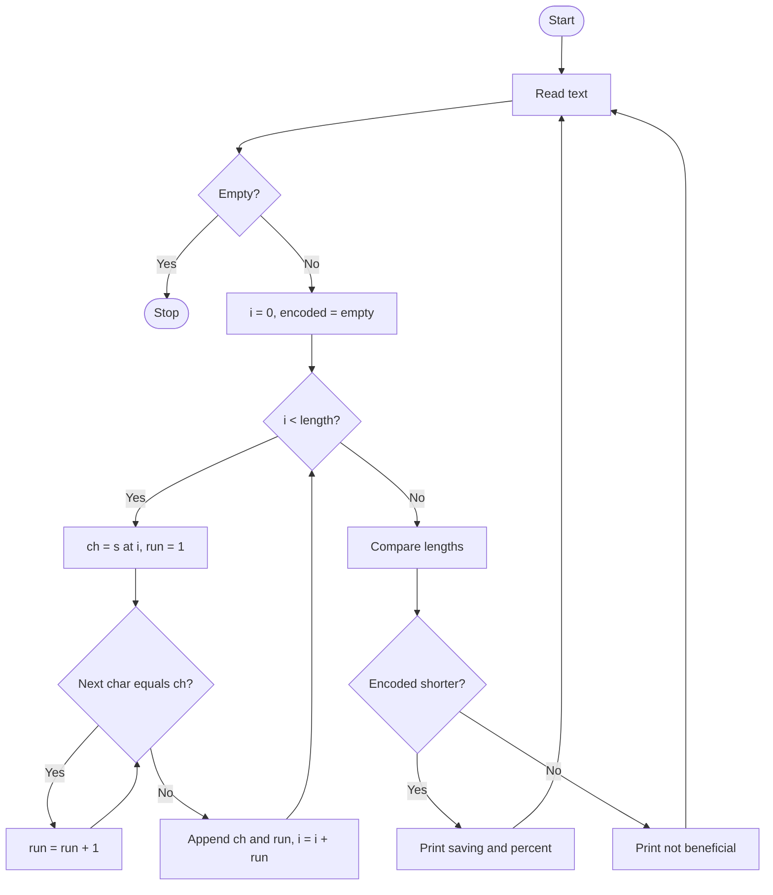

# Case Study 5: Text Compression Using Character Runs
*(Original list number: 35)*

## 1. Problem Statement
Encode a string by replacing every group of consecutive repeated characters with the character followed by its count (for example aaabb becomes a3b2). Compare the original and encoded lengths and decide whether encoding is beneficial.

## 2. Objectives
- Group consecutive repeated characters using nested while loops.
- Build a new string by concatenation.
- Compare lengths and compute the saving percentage.
- Handle cases where encoding is longer or equal.

## 3. Assumptions
- Input is plain text (letters, spaces or symbols).
- Format used is character followed by count, e.g. W12B1W4.
- An empty line ends the program.
- Decoding is not required.

## 4. Algorithm
1. Start; read a line of text; stop if it is empty.
2. Set i = 0 and encoded = empty string.
3. While i < length: take ch = s[i], set run = 1.
4. While the next character equals ch, increase run.
5. Append ch and run to encoded; add run to i.
6. Print both lengths.
7. If encoded is shorter, print saving and percentage; if equal or longer, say not beneficial.
8. Return to reading the next text.

## 5. Pseudocode
```text
START
  LOOP
      READ s
      IF s is empty THEN EXIT LOOP
      encoded <- ""; i <- 0
      WHILE i < length(s)
          ch <- s[i]; run <- 1
          WHILE i + run < length(s) AND s[i+run] = ch
              run <- run + 1
          encoded <- encoded + ch + string(run)
          i <- i + run
      ENDWHILE
      PRINT s, encoded, lengths
      IF length(encoded) < length(s) THEN
          PRINT saving and percentage
      ELSE
          PRINT "not beneficial, keep original"
  ENDLOOP
END
```

## 6. Flowchart


## 7. Python Source Code
The full program is in [`program.py`](program.py).

```python
# ============================================================
# Case Study 5: Text Compression Using Character Runs (RLE)
# Uses: strings, while loops, nested loops, conditions
# ============================================================

print("Run-Length Encoder (press Enter on an empty line to quit)")

while True:
    s = input("\nEnter text: ")
    if s == "":
        print("Goodbye!")
        break

    encoded = ""
    i = 0
    while i < len(s):
        ch = s[i]
        run = 1
        # count how many times this character repeats consecutively
        while i + run < len(s) and s[i + run] == ch:
            run = run + 1
        encoded = encoded + ch + str(run)      # e.g. "aaa" -> "a3"
        i = i + run                            # jump past the whole run

    print("Original :", s, "(length", len(s), ")")
    print("Encoded  :", encoded, "(length", len(encoded), ")")

    if len(encoded) < len(s):
        saved = len(s) - len(encoded)
        percent = saved * 100 / len(s)
        print("Result   : Compression BENEFICIAL - saved", saved,
              "characters (" + str(round(percent, 1)) + "%)")
    elif len(encoded) == len(s):
        print("Result   : No change in size - encoding not beneficial, keep original")
    else:
        extra = len(encoded) - len(s)
        print("Result   : Encoding made it", extra, "characters LONGER - not beneficial, keep original")
```

## 8. Test Cases
| No. | Test Case | Input | Expected Output |
|-----|-----------|-------|-----------------|
| 1 | Beneficial | aaabbbcccc | a3b3c4 (6 vs 10), saved 4 characters (40.0%) |
| 2 | Longer result | abc | a1b1c1 (6 vs 3), encoding made it 3 characters longer |
| 3 | Equal length | aabb | a2b2 (4 vs 4), no change, not beneficial |
| 4 | Classic example | WWWWWWWWWWWWBWWWW | W12B1W4 (7 vs 17), saved 10 characters (58.8%) |
| 5 | Quit | (empty line) | Goodbye! |

## 9. Output Screenshot
Run `python program.py`, take a screenshot of the terminal and save it as `screenshots/output.png`.


Text copy of the output: [`sample_output.txt`](sample_output.txt)

```text
Run-Length Encoder (press Enter on an empty line to quit)

Enter text: Original : aaabbbcccc (length 10 )
Encoded  : a3b3c4 (length 6 )
Result   : Compression BENEFICIAL - saved 4 characters (40.0%)

Enter text: Original : abc (length 3 )
Encoded  : a1b1c1 (length 6 )
Result   : Encoding made it 3 characters LONGER - not beneficial, keep original

Enter text: Original : aabb (length 4 )
Encoded  : a2b2 (length 4 )
Result   : No change in size - encoding not beneficial, keep original

Enter text: Original : WWWWWWWWWWWWBWWWW (length 17 )
Encoded  : W12B1W4 (length 7 )
Result   : Compression BENEFICIAL - saved 10 characters (58.8%)

Enter text: Goodbye!
```

## 10. Conclusion
The program implements run-length encoding with nested loops and reports honestly when compression does not help. It shows how careful loop control (jumping the index by the run length) avoids double counting.
