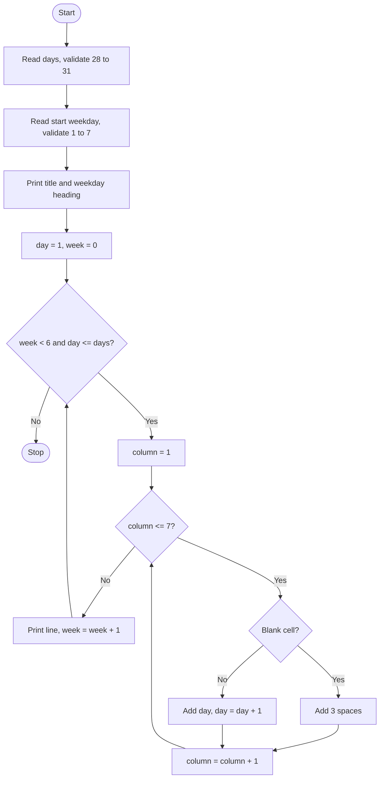

# Case Study 6: Nested Loop Calendar Generator
*(Original list number: 37)*

## 1. Problem Statement
Print a formatted monthly calendar from the starting weekday and number of days of the month. Dates must be aligned under the weekday headings, with blank cells before the first date and after the last date.

## 2. Objectives
- Use nested loops (weeks and columns) to build a table-like output.
- Validate month length and weekday number.
- Align one-digit and two-digit dates in fixed-width cells.
- Handle months of 28, 29, 30 and 31 days.

## 3. Assumptions
- Number of days must be 28 to 31.
- Starting weekday is a number: 1 = Monday ... 7 = Sunday.
- The week starts on Monday.
- A month needs at most 6 week-rows.
- The month name is only used as a title.

## 4. Algorithm
1. Start; read days and keep asking until 28 <= days <= 31.
2. Read starting weekday until 1 to 7; read month name.
3. Print the title and heading Mo Tu We Th Fr Sa Su.
4. Set day = 1.
5. For each week (maximum 6): stop if day > days.
6. For columns 1 to 7: print blank if (first week and column < start) or day > days, else print day with width 3 and increase day.
7. Print the line; stop after the last week.

## 5. Pseudocode
```text
START
  REPEAT READ days UNTIL 28 <= days <= 31
  REPEAT READ start UNTIL 1 <= start <= 7
  READ month_name
  PRINT month_name and heading "Mo Tu We Th Fr Sa Su"
  day <- 1
  FOR week FROM 0 TO 5
      IF day > days THEN BREAK
      line <- ""
      FOR column FROM 1 TO 7
          IF (week = 0 AND column < start) OR day > days
              THEN line <- line + 3 spaces
          ELSE
              line <- line + day padded to width 3
              day <- day + 1
      PRINT line
  ENDFOR
END
```

## 6. Flowchart


## 7. Python Source Code
The full program is in [`program.py`](program.py).

```python
# ============================================================
# Case Study 6: Nested Loop Calendar Generator
# Uses: nested loops, strings, validation, conditions
# ============================================================

# ---- Input with validation ----
while True:
    t = input("Number of days in the month (28-31): ").strip()
    if t.isdigit() and 28 <= int(t) <= 31:
        days = int(t)
        break
    print("Invalid! A month has 28, 29, 30 or 31 days.")

while True:
    t = input("Starting weekday (1=Mon, 2=Tue, ... 7=Sun): ").strip()
    if t.isdigit() and 1 <= int(t) <= 7:
        start = int(t)
        break
    print("Invalid! Enter a number from 1 to 7.")

month_name = input("Month name (for the title): ").strip()

# ---- Print the calendar ----
print()
print("      " + month_name)
print("Mo Tu We Th Fr Sa Su")

day = 1                                  # next date to print
for week in range(6):                    # a month needs at most 6 week-rows
    if day > days:
        break                            # all dates printed, stop early
    line = ""
    for column in range(1, 8):           # columns 1 (Mon) .. 7 (Sun)
        if week == 0 and column < start:
            line = line + "   "          # blank cell before the 1st
        elif day > days:
            line = line + "   "          # blank cell after the last date
        else:
            if day < 10:
                line = line + " " + str(day) + " "    # width = 3 characters
            else:
                line = line + str(day) + " "
            day = day + 1
    print(line)
```

## 8. Test Cases
| No. | Test Case | Input | Expected Output |
|-----|-----------|-------|-----------------|
| 1 | 31 days from Wednesday | 31, 3, October | Row 1 has 3 blanks then 1 2 3 4 5; last row 27 to 31 |
| 2 | 30 days from Sunday | 30, 7, November | 1 appears under Su; 30 alone on the 6th row |
| 3 | Invalid days | 35, then 30 | Error message, asks again |
| 4 | Invalid weekday | 9, 0, then 7 | Error message twice, then accepted |
| 5 | February (28 days, Monday start) | 28, 1, February | Exactly 4 full rows |

## 9. Output Screenshot
Run `python program.py`, take a screenshot of the terminal and save it as `screenshots/output.png`.


Text copy of the output: [`sample_output.txt`](sample_output.txt)

```text
Number of days in the month (28-31): Starting weekday (1=Mon, 2=Tue, ... 7=Sun): Month name (for the title): 
      October 2026
Mo Tu We Th Fr Sa Su
          1  2  3  4 
 5  6  7  8  9 10 11 
12 13 14 15 16 17 18 
19 20 21 22 23 24 25 
26 27 28 29 30 31    
```

## 10. Conclusion
The program prints a neatly aligned calendar using two nested loops and fixed-width cells. Validation guarantees that only realistic month lengths and weekdays are accepted. (Tip: October 2026 starts on Thursday, so use weekday 4.)
