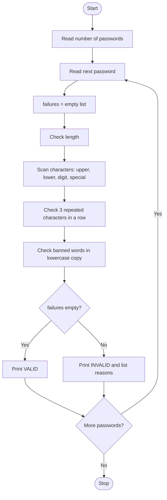

# Case Study 4: Password Policy Validation Engine
*(Original list number: 29)*

## 1. Problem Statement
Check a number of password strings against a policy: minimum length, required character categories, no repeated characters and no prohibited substrings. For each password, explain every rule that failed.

## 2. Objectives
- Scan strings character by character using loops.
- Check character categories without library functions.
- Detect three identical characters in a row and banned substrings.
- Collect all failures in a list and display them clearly.

## 3. Assumptions
- Minimum length = 8.
- Need at least one uppercase, lowercase, digit and special character from !@#$%^&*.
- No character may appear 3 or more times consecutively.
- Prohibited words (case-insensitive): password, admin, 1234, qwerty.
- The user decides how many passwords to check.

## 4. Algorithm
1. Start; read how many passwords to test (positive whole number).
2. For each password, create an empty failures list.
3. If length < 8, add a failure.
4. Loop through characters and set flags for uppercase, lowercase, digit, special.
5. Add a failure for every missing category.
6. Compare each character with the next two; if all equal, add a failure and stop checking.
7. Convert to lowercase; for each banned word, if it is inside the password add a failure.
8. If failures list is empty print VALID, else print each failure.
9. Stop after the last password.

## 5. Pseudocode
```text
START
  READ count (positive integer)
  FOR number FROM 1 TO count
      READ pw
      failures <- empty list
      IF length(pw) < 8 THEN add "too short"
      has_upper, has_lower, has_digit, has_special <- FALSE
      FOR each ch IN pw
          IF ch is A-Z THEN has_upper <- TRUE
          ELSE IF ch is a-z THEN has_lower <- TRUE
          ELSE IF ch is 0-9 THEN has_digit <- TRUE
          ELSE IF ch IN specials THEN has_special <- TRUE
      add a failure for each flag still FALSE
      FOR i FROM 0 TO length-3
          IF pw[i] = pw[i+1] = pw[i+2] THEN add failure; BREAK
      low <- lowercase(pw)
      FOR each word IN banned
          IF word inside low THEN add failure
      IF failures empty THEN PRINT VALID
      ELSE PRINT INVALID and every failure
  ENDFOR
END
```

## 6. Flowchart


## 7. Python Source Code
The full program is in [`program.py`](program.py).

```python
# ============================================================
# Case Study 4: Password Policy Validation Engine
# Uses: strings, loops, lists, conditions
# ============================================================

MIN_LENGTH = 8
SPECIALS = "!@#$%^&*"
BANNED = ["password", "admin", "1234", "qwerty"]

while True:
    t = input("How many passwords to check? ").strip()
    if t.isdigit() and int(t) > 0:
        count = int(t)
        break
    print("Enter a positive whole number.")

for number in range(1, count + 1):
    pw = input("\nPassword " + str(number) + ": ")
    failures = []                       # list of explanation strings

    # Rule 1: length
    if len(pw) < MIN_LENGTH:
        failures.append("Too short: " + str(len(pw)) + " characters (minimum " + str(MIN_LENGTH) + ")")

    # Rule 2: character categories (checked with a loop over characters)
    has_upper = False
    has_lower = False
    has_digit = False
    has_special = False
    for ch in pw:
        if "A" <= ch <= "Z":
            has_upper = True
        elif "a" <= ch <= "z":
            has_lower = True
        elif "0" <= ch <= "9":
            has_digit = True
        elif ch in SPECIALS:
            has_special = True
    if not has_upper:
        failures.append("No uppercase letter")
    if not has_lower:
        failures.append("No lowercase letter")
    if not has_digit:
        failures.append("No digit")
    if not has_special:
        failures.append("No special character from " + SPECIALS)

    # Rule 3: no character repeated 3 times in a row
    for i in range(len(pw) - 2):
        if pw[i] == pw[i + 1] and pw[i + 1] == pw[i + 2]:
            failures.append("Character '" + pw[i] + "' repeated 3+ times in a row")
            break

    # Rule 4: prohibited substrings (case-insensitive)
    low = pw.lower()
    for word in BANNED:
        if word in low:
            failures.append("Contains prohibited text '" + word + "'")

    if len(failures) == 0:
        print("RESULT: VALID - password meets all rules")
    else:
        print("RESULT: INVALID -", len(failures), "rule(s) failed")
        for f in failures:
            print("  -", f)
```

## 8. Test Cases
| No. | Test Case | Input | Expected Output |
|-----|-----------|-------|-----------------|
| 1 | Valid | Hello@123 | VALID |
| 2 | Banned word, missing categories | password | INVALID - 4 rules: no uppercase, no digit, no special, contains 'password' |
| 3 | Repeated characters | AAAbc1!x | INVALID - 'A' repeated 3+ times |
| 4 | Too short | Ab1! | INVALID - too short: 4 characters |
| 5 | Strong password | Secure#Pass9 | VALID |

## 9. Output Screenshot
Run `python program.py`, take a screenshot of the terminal and save it as `screenshots/output.png`.


Text copy of the output: [`sample_output.txt`](sample_output.txt)

```text
How many passwords to check? 
Password 1: RESULT: VALID - password meets all rules

Password 2: RESULT: INVALID - 4 rule(s) failed
  - No uppercase letter
  - No digit
  - No special character from !@#$%^&*
  - Contains prohibited text 'password'

Password 3: RESULT: INVALID - 1 rule(s) failed
  - Character 'A' repeated 3+ times in a row

Password 4: RESULT: INVALID - 1 rule(s) failed
  - Too short: 4 characters (minimum 8)

Password 5: RESULT: VALID - password meets all rules
```

## 10. Conclusion
The validator reports every failed rule instead of stopping at the first one, which gives useful feedback. It uses only loops, comparisons, lists and strings, matching the syllabus.
