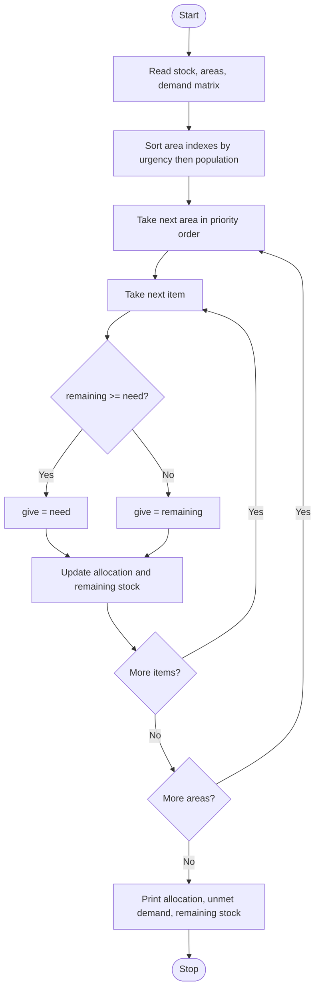

# Case Study 10: Disaster Relief Supply Allocation
*(Original list number: 94)*

## 1. Problem Statement
Limited relief supplies must be shared among several affected areas. Compare the stock with area-wise requirements, prioritise urgent areas, allocate supplies by a prescribed policy and calculate the remaining unmet demand and leftover stock.

## 2. Objectives
- Combine tuples (area details), lists (stock) and a nested list (demand matrix).
- Sort areas by priority using bubble sort on an index list.
- Allocate each item without exceeding available stock.
- Calculate unmet demand per area and remaining stock.

## 3. Assumptions
- 3 item types: food kits, water cans, medicine kits.
- Urgency 1 = most urgent, 3 = least urgent.
- Policy: serve areas by urgency (lower number first); if urgency is equal, the larger population goes first.
- Each area gets what it needs if stock allows, otherwise whatever stock is left (partial allocation).
- Stock: 500 food, 400 water, 200 medicine.

## 4. Algorithm
1. Start; store item names, stock, area tuples and the demand matrix.
2. Create an index list of areas and bubble sort it by (urgency, then population descending).
3. Create an allocation matrix filled with zeros and copy the stock into remaining.
4. For each area in priority order and for each item: give = min(need, remaining); store it and reduce remaining.
5. Print the priority order, allocation, unmet demand per area and remaining stock.
6. Add up total unmet units; stop.

## 5. Pseudocode
```text
START
  items, stock, areas (tuples), demand (nested list)
  order <- [0, 1, 2, ...]
  BUBBLE SORT order:
      swap neighbours if next has smaller urgency
      OR (same urgency AND larger population)
  allocation <- matrix of zeros
  remaining <- copy of stock
  FOR each idx IN order
      FOR each item j
          need <- demand[idx][j]
          IF remaining[j] >= need THEN give <- need
          ELSE give <- remaining[j]
          allocation[idx][j] <- give
          remaining[j] <- remaining[j] - give
  PRINT priority order
  PRINT allocation (given / demanded)
  PRINT unmet demand (demand - allocation) for every area
  PRINT remaining stock and total unmet units
END
```

## 6. Flowchart


## 7. Python Source Code
The full program is in [`program.py`](program.py).

```python
# ============================================================
# Case Study 10: Disaster Relief Supply Allocation
# Uses: lists, nested lists, tuples, unpacking, sorting, loops
# ============================================================

items = ["Food kits", "Water cans", "Medicine kits"]
stock = [500, 400, 200]                 # available stock of each item

# area tuple: (name, population, urgency)   urgency 1 = most urgent, 3 = least
areas = [
    ("Riverside",    1200, 1),
    ("Hilltop",       800, 2),
    ("Coastal Town", 2000, 1),
    ("Old Market",    500, 3),
]
# nested list: demand[i][j] = units of item j required by area i
demand = [
    [300, 250, 120],
    [200, 150,  60],
    [400, 300, 100],
    [150, 100,  40],
]

# ---- Priority order: lower urgency number first; larger population breaks ties ----
order = list(range(len(areas)))
for i in range(len(order) - 1):
    for j in range(len(order) - 1 - i):
        name1, pop1, urg1 = areas[order[j]]
        name2, pop2, urg2 = areas[order[j + 1]]
        swap = False
        if urg2 < urg1:
            swap = True
        elif urg2 == urg1 and pop2 > pop1:
            swap = True
        if swap:
            order[j], order[j + 1] = order[j + 1], order[j]

# ---- Allocation (policy: serve areas in priority order; give what is available) ----
allocation = []
for i in range(len(areas)):
    allocation.append([0, 0, 0])
remaining = stock[:]                    # copy of the stock list

for idx in order:
    for j in range(len(items)):
        need = demand[idx][j]
        if remaining[j] >= need:
            give = need
        else:
            give = remaining[j]         # only what is left
        allocation[idx][j] = give
        remaining[j] = remaining[j] - give

# ---- Report ----
print("PRIORITY ORDER:")
position = 1
for idx in order:
    name, pop, urg = areas[idx]
    print(" ", position, name, "(urgency " + str(urg) + ", population " + str(pop) + ")")
    position = position + 1

print("\nALLOCATION (given / demanded):")
total_unmet = 0
for idx in order:
    name = areas[idx][0]
    line = name.ljust(13)
    for j in range(len(items)):
        line = line + items[j] + " " + str(allocation[idx][j]) + "/" + str(demand[idx][j]) + "  "
        total_unmet = total_unmet + (demand[idx][j] - allocation[idx][j])
    print(line)

print("\nUNMET DEMAND BY AREA:")
for idx in order:
    name = areas[idx][0]
    parts = []
    for j in range(len(items)):
        short = demand[idx][j] - allocation[idx][j]
        if short > 0:
            parts.append(items[j] + ": " + str(short))
    if len(parts) == 0:
        print(" ", name, "- fully served")
    else:
        print(" ", name, "-", ", ".join(parts))

print("\nREMAINING STOCK:")
for j in range(len(items)):
    print(" ", items[j], "=", remaining[j])
print("Total unmet units:", total_unmet)
```

## 8. Test Cases
| No. | Test Case | Input | Expected Output |
|-----|-----------|-------|-----------------|
| 1 | Priority order | Built-in areas | Coastal Town, Riverside, Hilltop, Old Market |
| 2 | Tie on urgency | Coastal (2000) vs Riverside (1200), both urgency 1 | Coastal Town served first (bigger population) |
| 3 | Full service | Coastal Town | 400/400 food, 300/300 water, 100/100 medicine |
| 4 | Partial service | Riverside | 100/300 food, 100/250 water, 100/120 medicine |
| 5 | No stock left | Hilltop and Old Market | Receive 0 of every item |
| 6 | Totals | Whole run | Remaining stock 0 0 0; total unmet units 1070 |

## 9. Output Screenshot
Run `python program.py`, take a screenshot of the terminal and save it as `screenshots/output.png`.


Text copy of the output: [`sample_output.txt`](sample_output.txt)

```text
PRIORITY ORDER:
  1 Coastal Town (urgency 1, population 2000)
  2 Riverside (urgency 1, population 1200)
  3 Hilltop (urgency 2, population 800)
  4 Old Market (urgency 3, population 500)

ALLOCATION (given / demanded):
Coastal Town Food kits 400/400  Water cans 300/300  Medicine kits 100/100  
Riverside    Food kits 100/300  Water cans 100/250  Medicine kits 100/120  
Hilltop      Food kits 0/200  Water cans 0/150  Medicine kits 0/60  
Old Market   Food kits 0/150  Water cans 0/100  Medicine kits 0/40  

UNMET DEMAND BY AREA:
  Coastal Town - fully served
  Riverside - Food kits: 200, Water cans: 150, Medicine kits: 20
  Hilltop - Food kits: 200, Water cans: 150, Medicine kits: 60
  Old Market - Food kits: 150, Water cans: 100, Medicine kits: 40

REMAINING STOCK:
  Food kits = 0
  Water cans = 0
  Medicine kits = 0
Total unmet units: 1070
```

## 10. Conclusion
The program turns a priority policy into a clear, repeatable allocation. Nested lists store the demand matrix, tuples store area details and a sorted index list keeps the original data unchanged. Changing the stock or policy only needs small edits.
