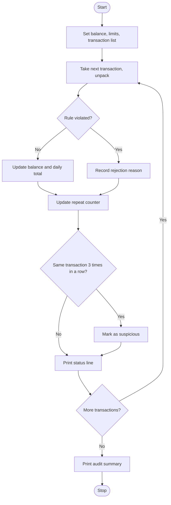

# Case Study 9: Multi-Stage ATM Transaction Audit
*(Original list number: 86)*

## 1. Problem Statement
Process a sequence of deposits, withdrawals and transfers on a simulated account. Maintain the balance, reject invalid operations with reasons, enforce limits and detect suspicious repeated patterns. Finish with an audit summary.

## 2. Objectives
- Process a list of transaction tuples with unpacking.
- Validate each transaction against several rules in the right order.
- Maintain a running balance and daily withdrawal total.
- Detect the same transaction repeated three times in a row.
- Produce a clear audit summary.

## 3. Assumptions
- Opening balance = Rs.10,000; minimum balance to maintain = Rs.500.
- Per-withdrawal limit = Rs.5,000; daily withdrawal limit = Rs.10,000; transfer limit = Rs.20,000.
- Types: D = deposit, W = withdrawal, T = transfer (needs a target account).
- Suspicious = same type and amount three times consecutively (rejected attempts also count).
- All transactions happen on the same day.

## 4. Algorithm
1. Start; set balance and limits; create transaction tuples.
2. For each transaction, unpack type, amount and target.
3. Validate: type must be D/W/T; amount > 0; for W check per-transaction limit, daily limit and minimum balance; for T check target, transfer limit and minimum balance.
4. If no reason to reject, update balance (and daily withdrawals for W) and count as accepted; else store (number, reason).
5. Update the repeat counter using the (type, amount) pair; at 3 in a row record the transaction as suspicious.
6. Print one line for each transaction.
7. Print the summary: counts, rejection reasons, suspicious positions, withdrawn total, final balance.

## 5. Pseudocode
```text
START
  balance <- 10000; withdrawn_today <- 0
  rejected <- empty list; suspicious <- empty list
  last_key <- ("", 0); run <- 0
  FOR each transaction t IN transactions
      UNPACK t INTO kind, amount, target
      reason <- ""
      IF kind not in D,W,T THEN reason <- "unknown type"
      ELSE IF amount <= 0 THEN reason <- "invalid amount"
      ELSE IF kind = W THEN
           check per-withdrawal limit, daily limit, minimum balance
      ELSE IF kind = T THEN
           check target present, transfer limit, minimum balance
      IF reason = "" THEN
           update balance (and withdrawn_today for W)
      ELSE append (number, reason) to rejected
      IF (kind, amount) = last_key THEN run <- run + 1
      ELSE run <- 1; last_key <- (kind, amount)
      IF run = 3 THEN append number to suspicious
      PRINT status line
  PRINT audit summary
END
```

## 6. Flowchart


## 7. Python Source Code
The full program is in [`program.py`](program.py).

```python
# ============================================================
# Case Study 9: Multi-Stage ATM Transaction Audit
# Uses: tuples, unpacking, lists, loops, conditions
# ============================================================

OPENING_BALANCE = 10000
MIN_BALANCE = 500            # balance must never fall below this
PER_WITHDRAWAL_LIMIT = 5000
DAILY_WITHDRAWAL_LIMIT = 10000
TRANSFER_LIMIT = 20000

# (type, amount, target account)   D = deposit, W = withdraw, T = transfer
transactions = [
    ("D", 5000, ""),
    ("W", 2000, ""),
    ("W", 2000, ""),
    ("W", 2000, ""),          # 3rd identical withdrawal in a row -> suspicious
    ("W", 6000, ""),          # above per-withdrawal limit
    ("T", 3000, "ACC205"),
    ("D", -200, ""),          # invalid amount
    ("W", 5000, ""),          # would exceed daily limit
    ("W", 4000, ""),
    ("T", 1600, "ACC310"),    # would break minimum balance
    ("X", 100, ""),           # unknown type
    ("T", 500, ""),           # missing target account
    ("D", 300, ""),
    ("D", 300, ""),
    ("D", 300, ""),           # 3 identical deposits -> suspicious
]

balance = OPENING_BALANCE
withdrawn_today = 0
accepted = 0
rejected = []                # list of (number, reason) tuples
suspicious = []              # list of transaction numbers
last_key = ("", 0)           # previous (type, amount)
run_length = 0               # how many times in a row the same transaction appeared

print("Opening balance:", balance)
print("No  Type Amount  Status    Balance")

number = 0
for t in transactions:
    number = number + 1
    kind, amount, target = t               # tuple unpacking
    reason = ""

    # ---- validation ----
    if kind != "D" and kind != "W" and kind != "T":
        reason = "unknown transaction type"
    elif amount <= 0:
        reason = "amount must be positive"
    elif kind == "W":
        if amount > PER_WITHDRAWAL_LIMIT:
            reason = "exceeds per-withdrawal limit"
        elif withdrawn_today + amount > DAILY_WITHDRAWAL_LIMIT:
            reason = "exceeds daily withdrawal limit"
        elif balance - amount < MIN_BALANCE:
            reason = "minimum balance would be broken"
    elif kind == "T":
        if target == "":
            reason = "missing target account"
        elif amount > TRANSFER_LIMIT:
            reason = "exceeds transfer limit"
        elif balance - amount < MIN_BALANCE:
            reason = "minimum balance would be broken"

    # ---- apply the transaction ----
    if reason == "":
        if kind == "D":
            balance = balance + amount
        elif kind == "W":
            balance = balance - amount
            withdrawn_today = withdrawn_today + amount
        else:
            balance = balance - amount
        accepted = accepted + 1
        status = "OK"
    else:
        rejected.append((number, reason))
        status = "REJECTED"

    # ---- suspicious repeated pattern (same type+amount 3 times in a row) ----
    if (kind, amount) == last_key:
        run_length = run_length + 1
    else:
        run_length = 1
        last_key = (kind, amount)
    if run_length == 3:
        suspicious.append(number)

    print(str(number).ljust(3), kind.ljust(4), str(amount).ljust(7), status.ljust(9), balance)

# ---- audit summary ----
print("\n===== AUDIT SUMMARY =====")
print("Transactions processed :", len(transactions))
print("Accepted               :", accepted)
print("Rejected               :", len(rejected))
for num, why in rejected:
    print("   #" + str(num), "-", why)
print("Suspicious patterns at :", suspicious if len(suspicious) > 0 else "none")
print("Total withdrawn today  :", withdrawn_today)
print("Final balance          :", balance)
```

## 8. Test Cases
| No. | Test Case | Input | Expected Output |
|-----|-----------|-------|-----------------|
| 1 | Over per-withdrawal limit | W 6000 | Rejected: exceeds per-withdrawal limit |
| 2 | Negative deposit | D -200 | Rejected: amount must be positive |
| 3 | Daily limit | W 5000 after 6000 withdrawn | Rejected: exceeds daily withdrawal limit |
| 4 | Minimum balance | T 1600 with balance 2000 | Rejected: minimum balance would be broken |
| 5 | Unknown type | X 100 | Rejected: unknown transaction type |
| 6 | Missing target | T 500 with no account | Rejected: missing target account |
| 7 | Repeated pattern | W 2000 three times; D 300 three times | Suspicious at #4 and #15 |
| 8 | Final result | Whole list | Accepted 9, rejected 6, withdrawn 10000, final balance 2900 |

## 9. Output Screenshot
Run `python program.py`, take a screenshot of the terminal and save it as `screenshots/output.png`.


Text copy of the output: [`sample_output.txt`](sample_output.txt)

```text
Opening balance: 10000
No  Type Amount  Status    Balance
1   D    5000    OK        15000
2   W    2000    OK        13000
3   W    2000    OK        11000
4   W    2000    OK        9000
5   W    6000    REJECTED  9000
6   T    3000    OK        6000
7   D    -200    REJECTED  6000
8   W    5000    REJECTED  6000
9   W    4000    OK        2000
10  T    1600    REJECTED  2000
11  X    100     REJECTED  2000
12  T    500     REJECTED  2000
13  D    300     OK        2300
14  D    300     OK        2600
15  D    300     OK        2900

===== AUDIT SUMMARY =====
Transactions processed : 15
Accepted               : 9
Rejected               : 6
   #5 - exceeds per-withdrawal limit
   #7 - amount must be positive
   #8 - exceeds daily withdrawal limit
   #10 - minimum balance would be broken
   #11 - unknown transaction type
   #12 - missing target account
Suspicious patterns at : [4, 15]
Total withdrawn today  : 10000
Final balance          : 2900
```

## 10. Conclusion
The audit program applies layered validation rules in a clear order, keeps the account consistent, and flags suspicious repetition. It shows how tuples, lists, unpacking and conditions combine in a banking simulation.
