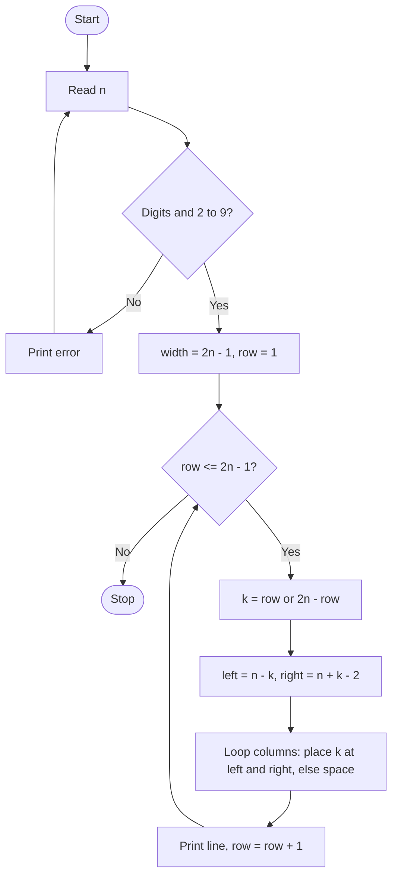

# Case Study 3: Advanced Numeric Pattern Generator (Hollow Diamond)
*(Original list number: 27)*

## 1. Problem Statement
Generate a hollow numeric diamond of height 2n-1 for a user-given n. Only the border of the diamond is printed, using the row number at both edges. Invalid sizes must be rejected and the output must stay aligned.

## 2. Objectives
- Use nested loops to build a symmetric pattern.
- Validate user input with a while loop and string checks.
- Calculate the column positions of the two border digits mathematically.
- Keep the output perfectly aligned.

## 3. Assumptions
- Valid size n is a whole number from 2 to 9 (so every number is a single digit and alignment is not broken).
- The diamond has 2n-1 rows and 2n-1 columns.
- The number printed on a row is its distance from the top (growing) then from the bottom (shrinking).

## 4. Algorithm
1. Start.
2. Repeat: read n as text; accept only if it is all digits and 2 <= n <= 9.
3. width = 2n - 1.
4. For row = 1 to 2n-1: if row <= n then k = row, else k = 2n - row.
5. left = n - k and right = n + k - 2 (0-indexed columns).
6. Build the line: for each column, add k if column is left or right, otherwise a space.
7. Print the line; stop after the last row.

## 5. Pseudocode
```text
START
  REPEAT
      READ text
  UNTIL text is digits AND 2 <= text <= 9
  n <- integer(text)
  width <- 2*n - 1
  FOR row FROM 1 TO 2*n - 1
      IF row <= n THEN k <- row ELSE k <- 2*n - row
      left <- n - k
      right <- n + k - 2
      line <- ""
      FOR col FROM 0 TO width - 1
          IF col = left OR col = right THEN line <- line + k
          ELSE line <- line + space
      PRINT line
  ENDFOR
END
```

## 6. Flowchart


## 7. Python Source Code
The full program is in [`program.py`](program.py).

```python
# ============================================================
# Case Study 3: Advanced Numeric Pattern Generator
# Hollow numeric diamond using nested loops
# ============================================================

# ---- Input validation: keep asking until 2 <= n <= 9 ----
while True:
    text = input("Enter diamond size n (2 to 9): ").strip()
    if text.isdigit() and 2 <= int(text) <= 9:
        n = int(text)
        break
    print("Invalid size! Enter a whole number from 2 to 9.")

width = 2 * n - 1            # total characters in the widest line
print()

for row in range(1, 2 * n):          # rows 1 .. 2n-1
    if row <= n:
        k = row                      # upper half: number grows
    else:
        k = 2 * n - row              # lower half: number shrinks
    left = n - k                     # column of the left digit (0-indexed)
    right = n + k - 2                # column of the right digit
    line = ""
    for col in range(width):         # build the line column by column
        if col == left or col == right:
            line = line + str(k)
        else:
            line = line + " "
    print(line)
```

## 8. Test Cases
| No. | Test Case | Input | Expected Output |
|-----|-----------|-------|-----------------|
| 1 | n = 4 | 4 | 7 lines; middle line is 4 spaces-4; top and bottom show 1 |
| 2 | n = 3 | 3 | 5-line diamond with 1, 2 2, 3 3, 2 2, 1 |
| 3 | n = 2 | 2 | 3-line diamond:  1 / 2 2 /  1 |
| 4 | Too large | 12 | Invalid size message, asks again |
| 5 | Too small | 1 | Invalid size message, asks again |
| 6 | Not a number | x | Invalid size message, asks again |

## 9. Output Screenshot
Run `python program.py`, take a screenshot of the terminal and save it as `screenshots/output.png`.


Text copy of the output: [`sample_output.txt`](sample_output.txt)

```text
Enter diamond size n (2 to 9): 
   1   
  2 2  
 3   3 
4     4
 3   3 
  2 2  
   1   
```

## 10. Conclusion
The program prints a perfectly aligned hollow numeric diamond using only nested loops and simple arithmetic on column positions. Input validation prevents invalid dimensions, which makes the program robust.
