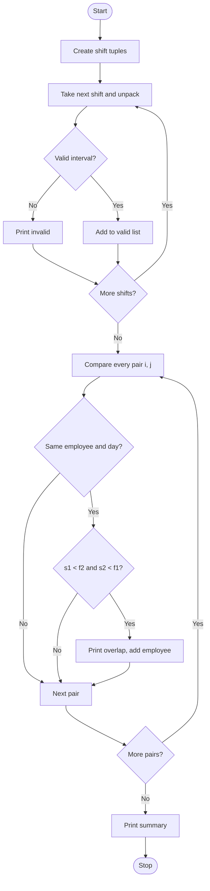

# Case Study 8: Tuple-Based Employee Shift Conflict Detection
*(Original list number: 48)*

## 1. Problem Statement
Employee shifts are stored as tuples (employee, day, start hour, end hour). Detect invalid shifts, compare time intervals of the same employee on the same day, report overlaps with their duration and list the employees who have conflicting schedules.

## 2. Objectives
- Store records as tuples and unpack them in loops.
- Validate time intervals.
- Apply the interval overlap rule: start1 < end2 and start2 < end1.
- Compare all pairs using nested loops.
- Report overlap duration and unique employee list.

## 3. Assumptions
- Times are whole hours in 24-hour format (0 to 24).
- A shift must end after it starts (no overnight shifts).
- Shifts that only touch (one ends exactly when the next starts) are NOT conflicts.
- Only shifts of the same employee on the same day are compared.

## 4. Algorithm
1. Start; create the list of shift tuples.
2. Unpack each tuple; if start < 0 or end > 24 or start >= end, report it as invalid; else add to valid list.
3. For i over valid shifts, for j after i, unpack both tuples.
4. If employee and day are equal and start1 < end2 and start2 < end1, there is a conflict.
5. Overlap hours = earliest end - latest start.
6. Print the conflict and add the employee to the conflict list if not already there.
7. Print total conflicts and the employee list; stop.

## 5. Pseudocode
```text
START
  shifts <- list of tuples (emp, day, start, end)
  valid <- empty list
  FOR each shift IN shifts
      UNPACK shift INTO emp, day, start, end
      IF start < 0 OR end > 24 OR start >= end THEN PRINT invalid
      ELSE append shift to valid
  conflicts <- 0; conflict_employees <- empty list
  FOR i FROM 0 TO length(valid) - 1
      FOR j FROM i+1 TO length(valid) - 1
          UNPACK valid[i] INTO e1, d1, s1, f1
          UNPACK valid[j] INTO e2, d2, s2, f2
          IF e1 = e2 AND d1 = d2 AND s1 < f2 AND s2 < f1 THEN
              overlap <- MIN(f1,f2) - MAX(s1,s2)
              PRINT conflict
              conflicts <- conflicts + 1
              IF e1 not in conflict_employees THEN append e1
  PRINT totals and employee list
END
```

## 6. Flowchart


## 7. Python Source Code
The full program is in [`program.py`](program.py).

```python
# ============================================================
# Case Study 8: Tuple-Based Employee Shift Conflict Detection
# Uses: tuples, tuple unpacking, lists, nested loops
# ============================================================

# Each shift is a tuple: (employee, day, start_hour, end_hour) in 24-hour time
shifts = [
    ("E01", "Mon", 9, 17),
    ("E02", "Mon", 9, 13),
    ("E01", "Mon", 16, 20),     # overlaps with E01's first shift
    ("E03", "Tue", 8, 16),
    ("E02", "Mon", 12, 18),     # overlaps with E02's first shift
    ("E03", "Tue", 16, 22),     # touches (not overlaps) E03's first shift
    ("E04", "Wed", 14, 10),     # invalid: ends before it starts
    ("E01", "Tue", 9, 17),
    ("E01", "Tue", 17, 23),     # back-to-back, no conflict
    ("E05", "Thu", 6, 26),      # invalid: hour above 24
]

# ---- Step 1: separate valid and invalid shifts ----
valid_shifts = []
print("=== VALIDATION ===")
for shift in shifts:
    emp, day, start, end = shift                  # unpacking
    if start < 0 or end > 24 or start >= end:
        print("INVALID shift:", shift)
    else:
        valid_shifts.append(shift)
print("Valid shifts:", len(valid_shifts), "| Invalid shifts:", len(shifts) - len(valid_shifts))

# ---- Step 2: compare every pair of valid shifts ----
print("\n=== CONFLICTS ===")
conflict_employees = []
conflict_count = 0
for i in range(len(valid_shifts)):
    for j in range(i + 1, len(valid_shifts)):
        e1, d1, s1, f1 = valid_shifts[i]
        e2, d2, s2, f2 = valid_shifts[j]
        if e1 == e2 and d1 == d2:                 # same employee, same day
            if s1 < f2 and s2 < f1:               # interval overlap test
                latest_start = s1
                if s2 > s1:
                    latest_start = s2
                earliest_end = f1
                if f2 < f1:
                    earliest_end = f2
                overlap = earliest_end - latest_start
                print(e1, d1, ":", (s1, f1), "overlaps", (s2, f2), "->", overlap, "hour(s)")
                conflict_count = conflict_count + 1
                if e1 not in conflict_employees:
                    conflict_employees.append(e1)

if conflict_count == 0:
    print("No conflicts found.")
else:
    print("\nTotal conflicts:", conflict_count)
    print("Employees with conflicting schedules:", ", ".join(conflict_employees))
```

## 8. Test Cases
| No. | Test Case | Input | Expected Output |
|-----|-----------|-------|-----------------|
| 1 | Overlapping shifts | E01 Mon (9,17) and (16,20) | Conflict, overlap 1 hour |
| 2 | Overlapping shifts | E02 Mon (9,13) and (12,18) | Conflict, overlap 1 hour |
| 3 | Touching shifts | E03 Tue (8,16) and (16,22) | No conflict |
| 4 | Back-to-back shifts | E01 Tue (9,17) and (17,23) | No conflict |
| 5 | End before start | E04 Wed (14,10) | INVALID shift |
| 6 | Hour above 24 | E05 Thu (6,26) | INVALID shift |
| 7 | Summary | All data | Valid 8, invalid 2, conflicts 2, employees E01 and E02 |

## 9. Output Screenshot
Run `python program.py`, take a screenshot of the terminal and save it as `screenshots/output.png`.


Text copy of the output: [`sample_output.txt`](sample_output.txt)

```text
=== VALIDATION ===
INVALID shift: ('E04', 'Wed', 14, 10)
INVALID shift: ('E05', 'Thu', 6, 26)
Valid shifts: 8 | Invalid shifts: 2

=== CONFLICTS ===
E01 Mon : (9, 17) overlaps (16, 20) -> 1 hour(s)
E02 Mon : (9, 13) overlaps (12, 18) -> 1 hour(s)

Total conflicts: 2
Employees with conflicting schedules: E01, E02
```

## 10. Conclusion
Tuples are a natural fit for fixed records, and unpacking made the comparison code readable. The overlap rule treats back-to-back shifts correctly, and the program clearly separates invalid data from real scheduling conflicts.
