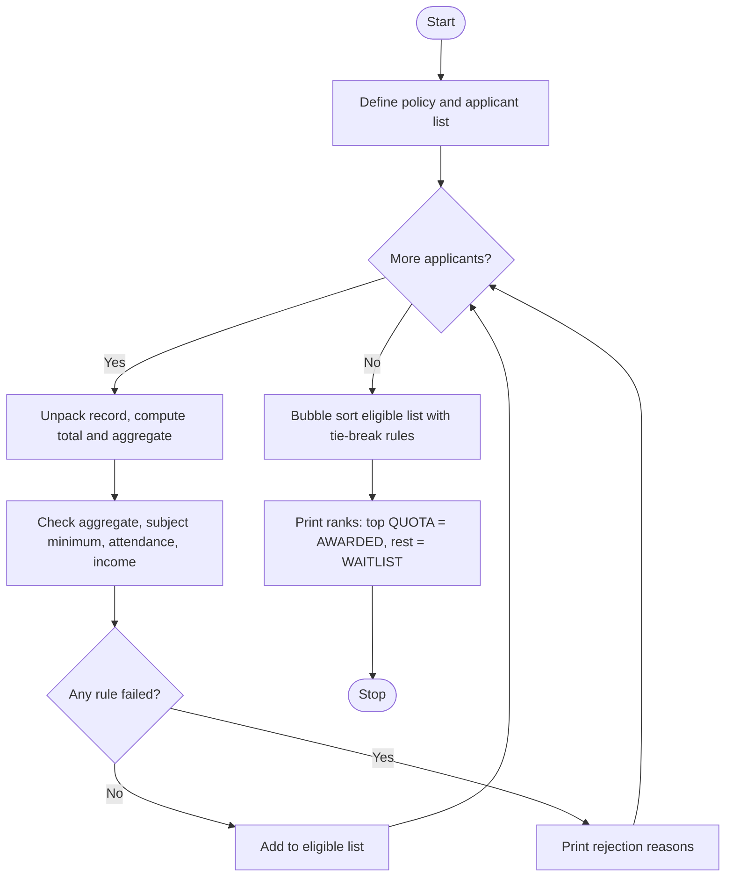

# Case Study 1: University Scholarship Allocation
*(Original list number: 1)*

## 1. Problem Statement
A university offers a limited number of scholarships. Each applicant has subject-wise marks, an attendance percentage and a family income. The system must check eligibility, rank the eligible students, resolve ties using fixed rules, and award scholarships according to the quota.

## 2. Objectives
- Apply aggregate, subject-wise minimum, attendance and income criteria together.
- Store applicants as tuples inside a list and use tuple unpacking.
- Rank eligible students manually using bubble sort (no built-in sort).
- Resolve ties with predefined tie-breaking rules.
- Print a clear reason for every rejected applicant.

## 3. Assumptions
- Every student has exactly 3 subjects, each marked out of 100.
- Minimum aggregate = 60%, minimum in each subject = 40, minimum attendance = 75%, maximum yearly income = Rs. 3,00,000.
- Number of scholarships (quota) = 3.
- Tie-break order: (1) higher total marks, (2) higher Maths marks, (3) lower family income, (4) smaller student ID.
- Applicant data is stored inside the program (no file input).

## 4. Algorithm
1. Start and define the policy constants and the applicant list of tuples.
2. For each applicant, unpack the tuple into id, name, marks, attendance, income.
3. Compute total and aggregate (total / number of subjects).
4. Check each rule; add a text reason to a list for every failed rule.
5. If the reasons list is empty, add the student to the eligible list; otherwise print the reasons.
6. Sort the eligible list with bubble sort using the tie-break order.
7. Print the ranked list: first QUOTA students are AWARDED, others WAITLIST.
8. Stop.

## 5. Pseudocode
```text
START
  SET policy constants (MIN_AGGREGATE, MIN_SUBJECT, MIN_ATTENDANCE, MAX_INCOME, QUOTA)
  CREATE list students of tuples (id, name, marks, attendance, income)
  CREATE empty list eligible
  FOR each record IN students
      UNPACK record INTO id, name, marks, attendance, income
      total <- sum of marks
      aggregate <- total / number of subjects
      reasons <- empty list
      IF aggregate < MIN_AGGREGATE THEN add reason
      FOR each subject mark
          IF mark < MIN_SUBJECT THEN add reason
      IF attendance < MIN_ATTENDANCE THEN add reason
      IF income > MAX_INCOME THEN add reason
      IF reasons is empty THEN append to eligible
      ELSE print reasons
  ENDFOR
  BUBBLE SORT eligible: swap neighbours if the next one has
        higher total OR (equal total AND higher Maths)
        OR (equal both AND lower income) OR (equal all AND smaller ID)
  rank <- 1
  FOR each student IN eligible
      IF rank <= QUOTA THEN result <- AWARDED ELSE result <- WAITLIST
      PRINT rank, id, name, total, result
      rank <- rank + 1
  ENDFOR
END
```

## 6. Flowchart


## 7. Python Source Code
The full program is in [`program.py`](program.py).

```python
# ============================================================
# Case Study 1: University Scholarship Allocation
# Uses: lists, tuples, tuple unpacking, loops, conditions
# ============================================================

# ---- Policy constants (change these to test other policies) ----
SUBJECTS = ["Maths", "Physics", "Programming"]
MIN_AGGREGATE = 60.0     # minimum average marks (%)
MIN_SUBJECT = 40         # minimum marks in EVERY subject
MIN_ATTENDANCE = 75      # minimum attendance (%)
MAX_INCOME = 300000      # maximum yearly family income (Rs.)
QUOTA = 3                # number of scholarships available

# ---- Applicant data: (id, name, [marks], attendance, income) ----
students = [
    ("S101", "Asha",   [88, 92, 79], 95, 250000),
    ("S102", "Bhanu",  [75, 80, 90], 82, 180000),
    ("S103", "Charan", [90, 70, 85], 90, 120000),
    ("S104", "Divya",  [55, 38, 70], 88, 150000),
    ("S105", "Esha",   [95, 96, 97], 70, 100000),
    ("S106", "Farhan", [60, 62, 58], 80, 450000),
    ("S107", "Gita",   [70, 72, 68], 91, 200000),
    ("S108", "Harsh",  [45, 50, 48], 85, 90000),
    ("S109", "Isha",   [80, 85, 75], 77, 280000),
    ("S110", "Jaya",   [65, 66, 64], 76, 290000),
]

eligible = []    # will hold (id, name, total, first_subject_marks, income, attendance)
print("=== STEP 1: ELIGIBILITY CHECK ===")

for record in students:
    sid, name, marks, attendance, income = record   # tuple unpacking

    total = 0
    for m in marks:
        total = total + m
    aggregate = total / len(marks)

    reasons = []                                    # list of failed conditions
    if aggregate < MIN_AGGREGATE:
        reasons.append("aggregate " + str(round(aggregate, 2)) + " < " + str(MIN_AGGREGATE))
    for i in range(len(marks)):
        if marks[i] < MIN_SUBJECT:
            reasons.append(SUBJECTS[i] + " " + str(marks[i]) + " < " + str(MIN_SUBJECT))
    if attendance < MIN_ATTENDANCE:
        reasons.append("attendance " + str(attendance) + " < " + str(MIN_ATTENDANCE))
    if income > MAX_INCOME:
        reasons.append("income " + str(income) + " > " + str(MAX_INCOME))

    if len(reasons) == 0:
        eligible.append((sid, name, total, marks[0], income, attendance))
        print(sid, name, "-> ELIGIBLE (aggregate", str(round(aggregate, 2)) + ")")
    else:
        print(sid, name, "-> REJECTED:", "; ".join(reasons))

# ---- Ranking using bubble sort ----
# Tie-break order: 1) higher total, 2) higher Maths marks,
#                  3) lower income, 4) smaller ID
n = len(eligible)
for i in range(n - 1):
    for j in range(n - 1 - i):
        a = eligible[j]
        b = eligible[j + 1]
        b_is_better = False
        if b[2] > a[2]:
            b_is_better = True
        elif b[2] == a[2]:
            if b[3] > a[3]:
                b_is_better = True
            elif b[3] == a[3]:
                if b[4] < a[4]:
                    b_is_better = True
                elif b[4] == a[4] and b[0] < a[0]:
                    b_is_better = True
        if b_is_better:
            eligible[j], eligible[j + 1] = b, a     # swap

print()
print("=== STEP 2: RANKED LIST (Quota =", QUOTA, ") ===")
print("Rank  ID    Name     Total  Maths  Income   Result")
rank = 1
for sid, name, total, maths, income, att in eligible:
    if rank <= QUOTA:
        result = "AWARDED"
    else:
        result = "WAITLIST"
    print(str(rank).ljust(5), sid.ljust(5), name.ljust(8), str(total).ljust(6),
          str(maths).ljust(6), str(income).ljust(8), result)
    rank = rank + 1

if len(eligible) == 0:
    print("No eligible applicants.")
```

## 8. Test Cases
| No. | Test Case | Input | Expected Output |
|-----|-----------|-------|-----------------|
| 1 | Sample data (10 applicants) | Built-in list | S101, S102, S103, S107, S109, S110 eligible; S104, S105, S106, S108 rejected |
| 2 | Tie on total (S102 vs S103, total 245) | Built-in | S103 ranks above S102 because Maths 90 > 75 |
| 3 | Subject below minimum | S104 Physics = 38 | Rejected: aggregate and Physics reasons shown |
| 4 | Low attendance | S105 attendance 70 | Rejected: attendance 70 < 75 |
| 5 | High income | S106 income 4,50,000 | Rejected: income above 300000 |
| 6 | Quota check | Quota = 3 | S101, S103, S102 AWARDED; S109, S107, S110 WAITLIST |

## 9. Output Screenshot
Run `python program.py`, take a screenshot of the terminal and save it as `screenshots/output.png`.


Text copy of the output: [`sample_output.txt`](sample_output.txt)

```text
=== STEP 1: ELIGIBILITY CHECK ===
S101 Asha -> ELIGIBLE (aggregate 86.33)
S102 Bhanu -> ELIGIBLE (aggregate 81.67)
S103 Charan -> ELIGIBLE (aggregate 81.67)
S104 Divya -> REJECTED: aggregate 54.33 < 60.0; Physics 38 < 40
S105 Esha -> REJECTED: attendance 70 < 75
S106 Farhan -> REJECTED: income 450000 > 300000
S107 Gita -> ELIGIBLE (aggregate 70.0)
S108 Harsh -> REJECTED: aggregate 47.67 < 60.0
S109 Isha -> ELIGIBLE (aggregate 80.0)
S110 Jaya -> ELIGIBLE (aggregate 65.0)

=== STEP 2: RANKED LIST (Quota = 3 ) ===
Rank  ID    Name     Total  Maths  Income   Result
1     S101  Asha     259    88     250000   AWARDED
2     S103  Charan   245    90     120000   AWARDED
3     S102  Bhanu    245    75     180000   AWARDED
4     S109  Isha     240    80     280000   WAITLIST
5     S107  Gita     210    70     200000   WAITLIST
6     S110  Jaya     195    65     290000   WAITLIST
```

## 10. Conclusion
The program evaluates all four eligibility criteria together, explains every rejection, and produces a repeatable ranking with clear tie-breaking. It shows how tuples, lists, unpacking and nested decisions solve a real allocation problem. It can be extended to read applicants from user input.
