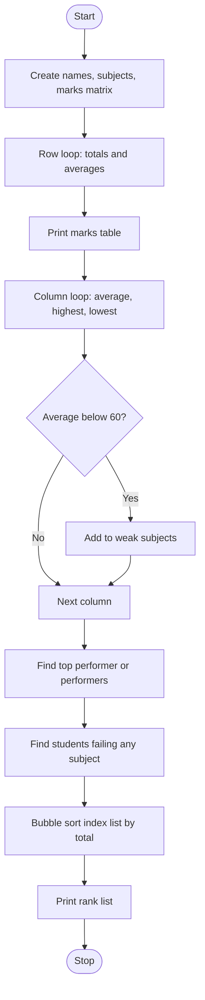

# Case Study 7: Student Marks Matrix Analysis
*(Original list number: 42)*

## 1. Problem Statement
Marks of several students in several subjects are stored in a matrix (nested list). Calculate row-wise totals and averages, column-wise statistics, identify the top performer(s), detect low-average subjects, list subject failures and rank the students.

## 2. Objectives
- Represent a table as a nested list and access marks[row][col].
- Calculate row-wise and column-wise statistics using nested loops.
- Find highest and lowest marks with the student names.
- Handle ties for the top performer.
- Rank students using bubble sort on an index list.

## 3. Assumptions
- 6 students and 4 subjects, marks out of 100.
- Pass mark in each subject = 35.
- A subject whose class average is below 60 is a low-average subject.
- Names and subjects are stored in separate lists with the same order as the matrix.

## 4. Algorithm
1. Start; create names, subjects and the marks matrix.
2. For each row, add the marks to get the total and compute the average.
3. Print the marks table with totals and averages.
4. For each column, compute average, highest (with name) and lowest (with name).
5. If the column average < 60, add the subject to the weak list.
6. Find the largest total and list every student who has it.
7. For each student, list subjects with marks below 35.
8. Create an index list and bubble sort it by total (descending).
9. Print the rank list; stop.

## 5. Pseudocode
```text
START
  names, subjects, marks (nested list)
  FOR each row r
      totals[r] <- sum of marks[r][c] over all c
      averages[r] <- totals[r] / number of subjects
  PRINT table
  FOR each column c
      sum, highest, lowest, and who has them <- scan all rows
      avg <- sum / number of students
      PRINT statistics
      IF avg < LOW_AVERAGE THEN add subject to weak list
  best <- maximum of totals
  PRINT every student whose total = best
  PRINT weak subjects
  FOR each row r
      collect subjects where marks[r][c] < PASS_MARK
      IF any THEN PRINT student and subjects
  order <- [0,1,2,...]
  BUBBLE SORT order by totals (high to low)
  PRINT rank list
END
```

## 6. Flowchart


## 7. Python Source Code
The full program is in [`program.py`](program.py).

```python
# ============================================================
# Case Study 7: Student Marks Matrix Analysis
# Uses: nested lists, nested loops, row/column statistics
# ============================================================

names = ["Anil", "Bhavya", "Chitra", "Deepak", "Eshwar", "Fatima"]
subjects = ["Maths", "Physics", "Chemistry", "Python"]
marks = [                       # nested list: one row per student
    [78, 82, 59, 91],
    [92, 88, 95, 97],
    [45, 38, 52, 60],
    [30, 42, 38, 55],
    [66, 71, 48, 80],
    [55, 49, 40, 72],
]
PASS_MARK = 35          # below this in any subject = fail in that subject
LOW_AVERAGE = 60        # subject average below this is flagged as weak

rows = len(marks)
cols = len(subjects)

# ---- Row-wise statistics ----
totals = []
averages = []
for r in range(rows):
    t = 0
    for c in range(cols):
        t = t + marks[r][c]
    totals.append(t)
    averages.append(t / cols)

# ---- Print the marks table ----
print("MARKS TABLE")
header = "Name".ljust(8)
for s in subjects:
    header = header + s.ljust(11)
print(header + "Total  Average")
for r in range(rows):
    line = names[r].ljust(8)
    for c in range(cols):
        line = line + str(marks[r][c]).ljust(11)
    print(line + str(totals[r]).ljust(7) + str(round(averages[r], 2)))

# ---- Column-wise statistics ----
print("\nSUBJECT STATISTICS")
weak_subjects = []
for c in range(cols):
    col_total = 0
    highest = marks[0][c]
    lowest = marks[0][c]
    high_name = names[0]
    low_name = names[0]
    for r in range(rows):
        value = marks[r][c]
        col_total = col_total + value
        if value > highest:
            highest = value
            high_name = names[r]
        if value < lowest:
            lowest = value
            low_name = names[r]
    avg = col_total / rows
    print(subjects[c].ljust(10), "average", str(round(avg, 2)).ljust(6),
          "highest", highest, "(" + high_name + ")",
          "lowest", lowest, "(" + low_name + ")")
    if avg < LOW_AVERAGE:
        weak_subjects.append(subjects[c])

# ---- Top performer(s): handles ties ----
best = totals[0]
for t in totals:
    if t > best:
        best = t
top = []
for r in range(rows):
    if totals[r] == best:
        top.append(names[r])
print("\nTOP PERFORMER(S):", ", ".join(top), "with total", best)

# ---- Weak subjects ----
if len(weak_subjects) == 0:
    print("No subject has an average below", LOW_AVERAGE)
else:
    print("LOW-AVERAGE SUBJECT(S) (below " + str(LOW_AVERAGE) + "):", ", ".join(weak_subjects))

# ---- Students failing any subject ----
print("\nSUBJECT FAILURES (below " + str(PASS_MARK) + ")")
anyone = False
for r in range(rows):
    failed = []
    for c in range(cols):
        if marks[r][c] < PASS_MARK:
            failed.append(subjects[c])
    if len(failed) > 0:
        print(names[r], "failed in", ", ".join(failed))
        anyone = True
if not anyone:
    print("None")

# ---- Rank list (bubble sort on an index list) ----
order = list(range(rows))
for i in range(rows - 1):
    for j in range(rows - 1 - i):
        if totals[order[j]] < totals[order[j + 1]]:
            order[j], order[j + 1] = order[j + 1], order[j]
print("\nRANK LIST")
for position in range(rows):
    idx = order[position]
    print(position + 1, names[idx], totals[idx])
```

## 8. Test Cases
| No. | Test Case | Input | Expected Output |
|-----|-----------|-------|-----------------|
| 1 | Totals | Built-in matrix | Anil 310, Bhavya 372, Chitra 195, Deepak 165, Eshwar 265, Fatima 216 |
| 2 | Top performer | Built-in | Bhavya with total 372 |
| 3 | Subject averages | Built-in | Maths 61.0, Physics 61.67, Chemistry 55.33, Python 75.83 |
| 4 | Low-average subject | Threshold 60 | Chemistry flagged |
| 5 | Failures | Pass mark 35 | Deepak failed in Maths (30) |
| 6 | Rank order | Built-in | Bhavya, Anil, Eshwar, Fatima, Chitra, Deepak |

## 9. Output Screenshot
Run `python program.py`, take a screenshot of the terminal and save it as `screenshots/output.png`.


Text copy of the output: [`sample_output.txt`](sample_output.txt)

```text
MARKS TABLE
Name    Maths      Physics    Chemistry  Python     Total  Average
Anil    78         82         59         91         310    77.5
Bhavya  92         88         95         97         372    93.0
Chitra  45         38         52         60         195    48.75
Deepak  30         42         38         55         165    41.25
Eshwar  66         71         48         80         265    66.25
Fatima  55         49         40         72         216    54.0

SUBJECT STATISTICS
Maths      average 61.0   highest 92 (Bhavya) lowest 30 (Deepak)
Physics    average 61.67  highest 88 (Bhavya) lowest 38 (Chitra)
Chemistry  average 55.33  highest 95 (Bhavya) lowest 38 (Deepak)
Python     average 75.83  highest 97 (Bhavya) lowest 55 (Deepak)

TOP PERFORMER(S): Bhavya with total 372
LOW-AVERAGE SUBJECT(S) (below 60): Chemistry

SUBJECT FAILURES (below 35)
Deepak failed in Maths

RANK LIST
1 Bhavya 372
2 Anil 310
3 Eshwar 265
4 Fatima 216
5 Chitra 195
6 Deepak 165
```

## 10. Conclusion
Nested lists made it easy to compute both row-wise and column-wise statistics with nested loops. The program also shows how an index list can be sorted to rank students without disturbing the original matrix.
